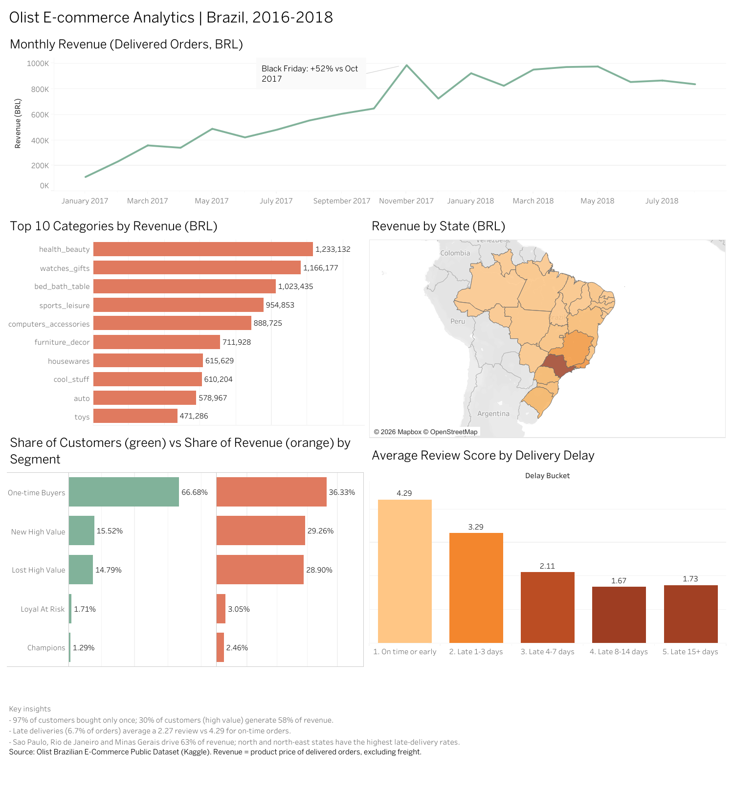

# Olist E-commerce Analytics (Brazil, 2016-2018)

End-to-end analysis of a Brazilian online marketplace: revenue growth, product and regional mix, customer retention (RFM and cohorts) and the effect of late delivery on customer reviews. Built with PostgreSQL, Python and Tableau Public.

**Live dashboard:** [Olist Dashboard on Tableau Public](https://public.tableau.com/app/profile/renuka.gomkale/viz/OlistDashboard_17951586732630/Dashboard)



## Business questions

1. How fast is revenue growing, and where does it come from (time, category, state)?
2. Who are the most valuable customers, and how many of them come back?
3. Does late delivery hurt customer satisfaction, and where is delivery weakest?

## Data

[Olist Brazilian E-Commerce Public Dataset](https://www.kaggle.com/datasets/olistbr/brazilian-ecommerce) from Kaggle: about 100K orders from 2016 to 2018 across 8 related tables (orders, order items, payments, reviews, customers, products, sellers, category translation). The geolocation table was not needed and is not used. The raw files are not included in this repository.

## Tools

- PostgreSQL 17: joins, CTEs, window functions (`NTILE`, `SUM() OVER`), views
- Python: pandas, SQLAlchemy, seaborn, matplotlib
- Tableau Public: 5 charts combined into one dashboard

## Key findings

**1. Revenue grew fast, then flattened**
- Jan-Aug 2018 revenue was R$7.2M vs R$3.0M in Jan-Aug 2017 (+141%).
- November 2017 (Black Friday) reached R$988K, 52% above October, then fell 26% in December.
- Growth stalled after May 2018 (R$978K in May, R$839K in August).

**2. Revenue is concentrated**
- Top 10 categories bring about 62% of revenue; the top 3 (health_beauty, watches_gifts, bed_bath_table) bring about 26%.
- bed_bath_table has the most orders, but watches_gifts earns roughly twice as much per order (about R$212 vs R$110).
- Sao Paulo alone is 38.3% of revenue; Sao Paulo, Rio de Janeiro and Minas Gerais together are 63.3%.

**3. Almost nobody buys twice**
- Of 93,358 customers with delivered orders, 97.0% bought only once. Only 2,801 (3.0%) came back.
- Monthly cohort retention averages 0.47% in month 1 and 0.24-0.35% in months 2-6. No cohort exceeds 0.72% in any month.
- Customers were identified with `customer_unique_id`. The `customer_id` column changes with every order and would have hidden repeat buyers.

**4. A small group of high-value customers drives revenue**

| Segment | Customers | Share of customers | Share of revenue | Avg spend (BRL) |
|---|---|---|---|---|
| One-time Buyers | 62,255 | 66.7% | 36.3% | 77 |
| New High Value | 14,491 | 15.5% | 29.3% | 267 |
| Lost High Value | 13,811 | 14.8% | 28.9% | 277 |
| Loyal At Risk | 1,599 | 1.7% | 3.0% | 252 |
| Champions | 1,202 | 1.3% | 2.5% | 271 |

- High-value customers (new and lost) are 30% of the base and 58% of revenue.
- Champions spend about the same in total as one-time high-value buyers, so a large first order is worth as much as repeat purchasing in this dataset.

**5. Late delivery is strongly linked to bad reviews**

| Delivery vs estimated date | Orders | Avg review | Reviews of 1-2 stars |
|---|---|---|---|
| On time or early | 89,443 | 4.29 | 9.2% |
| Late 1-3 days | 1,852 | 3.29 | 32.2% |
| Late 4-7 days | 1,748 | 2.11 | 67.6% |
| Late 8-14 days | 1,446 | 1.67 | 80.1% |
| Late 15+ days | 1,335 | 1.73 | 78.2% |

- Only 6.7% of orders are late, but they produce about one third of all 1-2 star reviews.
- A delay of just 1-3 days lowers the average review by one full point.
- 8 of the 10 states with the highest late rate are in the north and north-east (AL 20.8%, MA 17.1%, SE 15.0%), against 6.7% overall.
- Rio de Janeiro has an 11.9% late rate on 12,211 orders, roughly 23% of all late orders.

## Recommendations

1. Re-engage new customers within 30 days of the first purchase, when the chance of a repeat order is highest.
2. Run a win-back campaign for the 13.8K lapsed high-value customers.
3. Test increasing first-order value (bundles, upsell) alongside loyalty offers.
4. Set more realistic delivery estimates in AL, MA and SE, and review carrier performance in RJ.
5. Warn customers early when an order is likely to arrive late.

## Method notes and limitations

- Revenue is the sum of item prices of delivered orders. Freight is excluded.
- 2016 has very little data, so trend charts use Jan 2017 to Aug 2018.
- RFM: recency and monetary value are scored 1-5 with `NTILE(5)`. Frequency is scored 1, 3 or 5 for one, two or three-plus orders, because almost every customer has a single order. Recency is measured from the last order date in the data. "Lost" means relatively old, not confirmed churn.
- Late means delivered after the estimated delivery date. The link between lateness and reviews is an association, not proof of cause.
- Orders with more than one review use the average score. The state table includes states with at least 300 orders.
- Cohort retention is the share of a cohort that bought in exactly that month, not a running total. Cohorts are 4,000-7,000 customers, so small differences between cells are noise.

## Repository structure

```
sql/                 PostgreSQL scripts, run in numeric order
cohort_analysis.py   cohort retention table and heatmap
export_for_dashboard.py   exports summary CSVs for Tableau
test_connection.py   checks the Python to PostgreSQL connection
db_example.py        connection template (copy to db.py)
dashboard_data/      summary CSVs used by the dashboard
images/              dashboard and cohort heatmap images
requirements.txt     Python dependencies
```

## How to reproduce

1. Download the dataset from Kaggle and create a PostgreSQL database named `olist_db`.
2. Run `sql/01_create_tables.sql`, then import each CSV into its table (header on, comma delimiter).
3. Run `sql/02_data_check.sql` and compare the row counts, then run `03` to `05` in order.
4. Copy `db_example.py` to `db.py` and enter your PostgreSQL password.
5. Create a virtual environment and run `pip install -r requirements.txt`.
6. Run `python cohort_analysis.py` and `python export_for_dashboard.py`.
7. Load the CSVs in `dashboard_data/` into Tableau Public.

## Author

Renuka Gomkale - [GitHub](https://github.com/Renukagomkale)
